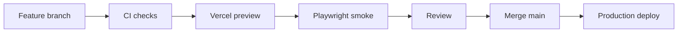

# CI/CD

## Branch flow

Push green, reviewable feature commits—not every file edit. Git remains the history; GitHub Actions and Vercel are the gates.

The generated delivery bundle may have no remote configured. In that case CI files are ready, but no push or Vercel deployment occurs until the owner adds a GitHub remote and project credentials.

## Integration branch (`development`) and release

Feature, fix and docs branches open a pull request into `development` (the cumulative integration branch). CI runs on the pull request; merge with a **merge commit** (no squash) once it is green. `main` is production/release only and is promoted from `development` only after explicit owner approval. Note: a push to `main` runs the `Database` workflow's `deploy-migrations` job, which links and pushes migrations to the hosted production project.

Hosted real-mode suites (`npm run test:real` — RPC/RLS with real JWTs, and `npm run test:real:ui` — three signed-in browser contexts) target the `the-lineup-dev` project, need DEV credentials and synthetic PINs, and are therefore **release evidence run by the developer**, not a CI job. Both refuse to run against anything but the DEV project. CI covers the deterministic checks and the local pgTAP suite (`supabase start` + `db reset` + `db:test`).

## Required checks

- dependency install from lockfile;
- formatting check;
- ESLint;
- TypeScript;
- unit/component tests;
- production build;
- migration and pgTAP checks when `supabase/**` changes;
- Playwright smoke against the preview for critical flows.

### Recorded exception: PR #131 (registry rate limit)

The `Database / migrations-and-policies` check failed four times for PR #131 at `supabase start` with `toomanyrequests: Data limit exceeded` (container-registry pull limit) before `db:reset` or `db:test` ran; the same failure hit an unrelated Dependabot branch. The owner approved merging PR #131 into `development` on independent evidence (35 migrations clean, pgTAP 25 files / 387 assertions, hosted DEV RPC/RLS 40/40, browser 15/15, Vitest 428, lint/typecheck/format/build). This exception is specific to PR #131 and is **not** a general red-CI bypass; CI stays mandatory. Follow-up delivered by INFRA-B (next section).

### Database job and registry limits (INFRA-B)

`supabase start` pulls images anonymously, and shared runner IPs hit registry limits (`toomanyrequests: Data limit exceeded`). `scripts/ci/supabase-start.mjs` starts the same reduced service set but pulls through `SUPABASE_INTERNAL_IMAGE_REGISTRY`: `ghcr.io`, then `public.ecr.aws`, then `docker.io` (all carry the pinned tags; `docker login` does not help because the CLI ignores stored credentials). It retries **only** output classified as a registry/network pull failure — at most 3 attempts, 15s/45s backoff, each logged as a `::warning::`. SQL, migration, pgTAP, config and unknown failures fail immediately. Nothing is skipped or `continue-on-error`; the `Database` check stays required. `deploy-migrations` runs only for pushes to `main`. Manual run: Actions → Database → Run workflow.

### Environment guard (INFRA-C)

`node scripts/check-nonprod-env.mjs [--env-file F] [--scan DIR]` fails if non-production configuration or build output references the PROD Supabase ref (or an unknown Supabase URL). `npm run check:env` checks `.env.development.local`; CI scans the `.next` output after the build. The hosted real-mode suites keep their own refusal to run against anything but DEV.

## Vercel

**Preview and Development deployments use the DEV Supabase project** (`opmujepkemwcdxxorhfd`); only Production uses PROD. The variable-by-variable mapping is in `docs/DEPLOYMENT.md` §5. Preview is a real-mode build, not a demo, so sign in with a synthetic DEV user; never commit credentials.

Use Vercel's Git integration for branch previews. Protect `main` so the production deployment begins only after required GitHub checks pass. If a custom pipeline is later required, pin Vercel CLI, run `vercel pull`, `vercel build`, test the prebuilt artifact, and `vercel deploy --prebuilt`.

Required CI secrets for a custom Vercel CLI pipeline are `VERCEL_TOKEN`, `VERCEL_ORG_ID`, and `VERCEL_PROJECT_ID`. They are not needed in repository files and must never be committed.

## Database delivery

1. Develop against local Supabase or an isolated branch.
2. Run database tests and advisors.
3. Commit a forward migration and regenerated TypeScript types.
4. Prefer additive/backward-compatible changes.
5. Apply production migration immediately before the compatible application release.
6. Verify a representative query and policy.
7. Remove old schema only in a later release.

Vercel rollback changes the application artifact, not the database. A production migration must therefore remain compatible with the previous application version until rollback risk passes.

## Review automation

The repository includes `.coderabbit.yaml`, but CodeRabbit runs only after its GitHub app is installed for the future repository. Treat its comments as review input, not an approval authority. High-risk authorization, migration, and concurrency changes require human review.

## Release checklist

- All checks green on the exact commit.
- Migration forward and rollback implications understood.
- Environment variable names present in Vercel; values not printed.
- Preview verified at manager desktop, host tablet, and server mobile widths.
- Supabase RLS and performance advisors reviewed.
- Error logging contains no secrets or guest notes.
- Post-deploy smoke test and error scan complete.
