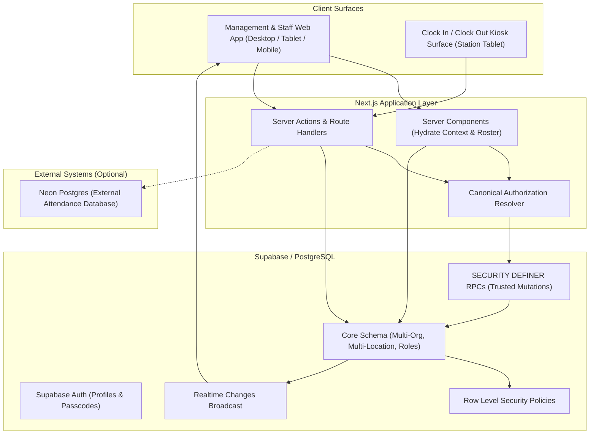
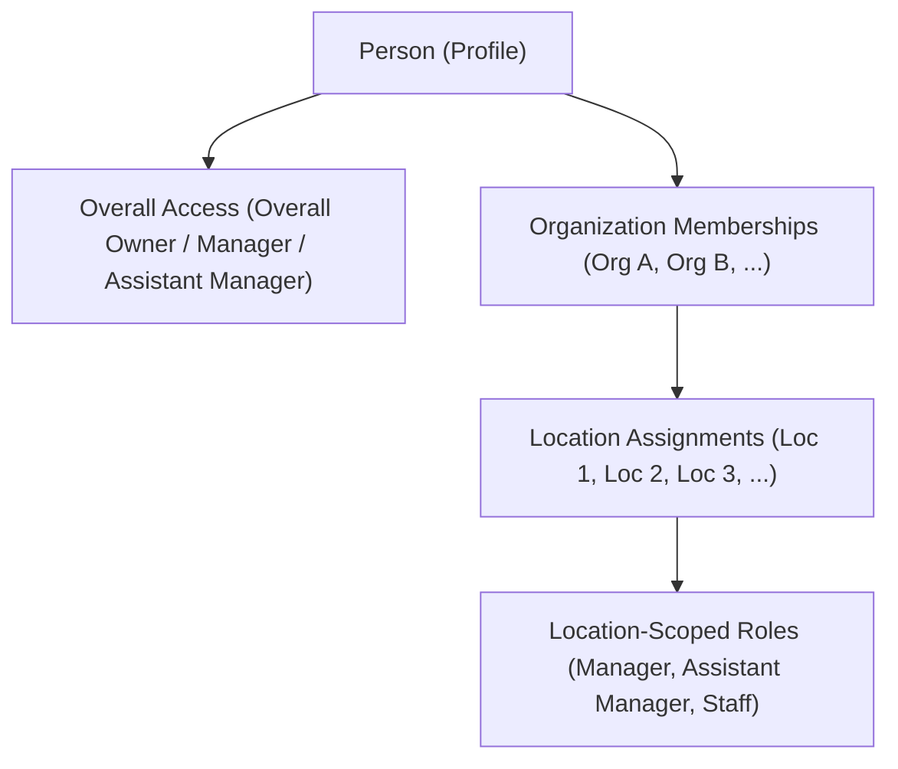
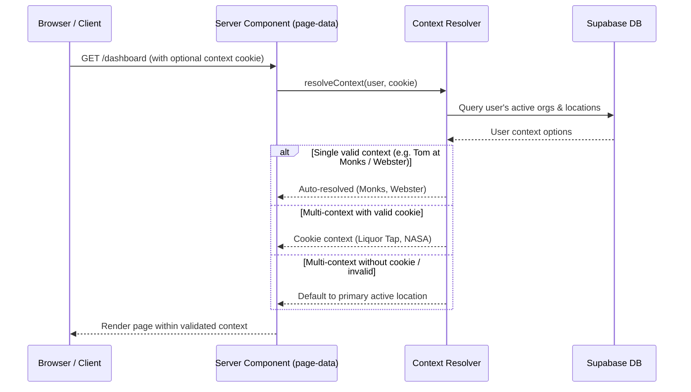
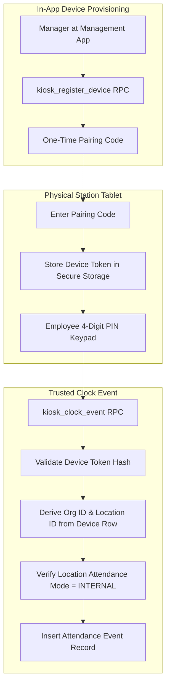

# The Lineup V2.0 — Architecture Specification

## 1. System Shape & Architecture Principles

The Lineup V2.0 preserves the modular monolith architecture established in V1: a unified Next.js application layer coupled to a single Supabase project providing PostgreSQL relational storage, Row Level Security (RLS), authentication, and Realtime event broadcast.

---

## 2. Multi-Tenant Identity & Access Hierarchy

In V2.0, a person is decoupled from a single organization or location. The access hierarchy is modeled as follows:

### Invariants:

1. **Profile**: Stable across organizations. Tied to `auth.users (id)`.
2. **Overall Access**: Baseline capabilities across all present and future organizations and locations.
3. **Organization Membership**: Validates that a person is an active affiliate of the organization (`memberships.active = true`).
4. **Location Assignment**: Validates that a person is explicitly assigned to work at a specific location.
5. **Effective Capability**: Computed via the canonical authorization resolver as the union of baseline overall capabilities, organization capabilities, and location-scoped capabilities.

---

## 3. Active Context Resolution

Operational screens require an active `(organization_id, location_id)` context.

### Context Rules:

- Context is hydrated server-side.
- If a user changes location in one tab, cross-tab synchronization alerts or syncs active operational state.
- Client-supplied context is **untrusted**: every mutation RPC verifies that the caller actually possesses valid membership and role at the target location.

---

## 4. Clock In / Out Kiosk Architecture

The Clock Kiosk is a first-class, dedicated application surface designed specifically for on-site physical tablets.

### Kiosk Trust Principles:

1. **Device Binding**: Kiosk device is bound to an exact `organization_id` and `location_id` in database record `kiosk_devices`.
2. **Zero Physical Geolocation**: Strictly prohibits browser geolocation, GPS, IP allowlists, or Wi-Fi scanning.
3. **Server-Derivation**: The client sends only employee PIN and device token. The server derives the location from the device binding.
4. **Fail-Closed**: If a device is revoked or its location is in `EXTERNAL` or `DISABLED` attendance mode, clock events fail immediately.

---

## 5. Attendance Operational Modes

Every location maintains an explicit `attendance_mode`:

| Mode                  | Behavior                                                                                           | Data Source                  |
| --------------------- | -------------------------------------------------------------------------------------------------- | ---------------------------- |
| `EXTERNAL`            | Reads and reports attendance from the external Neon database; internal kiosk clocking is disabled. | External Neon Postgres       |
| `INTERNAL_THE_LINEUP` | Native Lineup clock-in/out records via Kiosk and manager adjustment tools.                         | Supabase `attendance_events` |
| `DISABLED`            | All attendance features and navigation are hidden and backend endpoints fail-closed.               | None                         |
