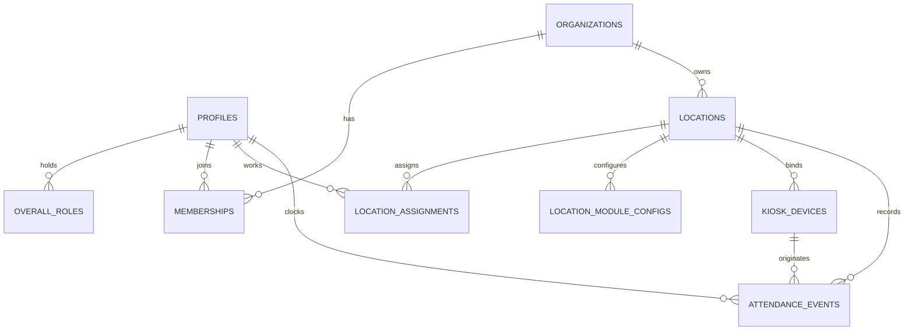

# The Lineup V2.0 — Data Model Specification

## 1. Entity-Relationship Overview



---

## 2. Core V2.0 Entities and Schemas

### 2.1. `overall_roles`

Stores baseline system-wide role assignments that apply across all organizations and locations.

```sql
create type public.overall_role as enum (
  'overall_owner',
  'overall_manager',
  'overall_assistant_manager'
);

create table public.overall_roles (
  id bigint generated always as identity primary key,
  profile_id uuid not null references public.profiles (id) on delete cascade,
  role public.overall_role not null,
  created_at timestamptz not null default now(),
  created_by uuid references public.profiles (id),
  unique (profile_id, role)
);
```

### 2.2. `locations` (Enhanced for V2)

Represents physical restaurant branches under an organization.

```sql
create type public.attendance_mode as enum (
  'external',
  'internal_the_lineup',
  'disabled'
);

-- Existing table enhanced with attendance_mode
alter table public.locations
  add column attendance_mode public.attendance_mode not null default 'external';
```

### 2.3. `location_assignments`

Maps an employee profile to a specific location with a scoped role and designation.

```sql
create table public.location_assignments (
  id bigint generated always as identity primary key,
  organization_id uuid not null references public.organizations (id) on delete cascade,
  location_id uuid not null,
  profile_id uuid not null references public.profiles (id) on delete cascade,
  role public.app_role not null,
  active boolean not null default true,
  created_at timestamptz not null default now(),
  updated_at timestamptz not null default now(),
  unique (location_id, profile_id),
  foreign key (location_id, organization_id)
    references public.locations (id, organization_id) on delete cascade,
  foreign key (organization_id, profile_id)
    references public.memberships (organization_id, profile_id) on delete cascade
);
```

### 2.4. `location_module_configs`

Configures enabled/disabled states and module-specific settings per location.

```sql
create table public.location_module_configs (
  id bigint generated always as identity primary key,
  organization_id uuid not null references public.organizations (id) on delete cascade,
  location_id uuid not null,
  module_key text not null check (module_key ~ '^[a-z0-9_-]+$'),
  is_enabled boolean not null default true,
  settings jsonb not null default '{}'::jsonb check (jsonb_typeof(settings) = 'object'),
  updated_at timestamptz not null default now(),
  updated_by uuid,
  unique (location_id, module_key),
  foreign key (location_id, organization_id)
    references public.locations (id, organization_id) on delete cascade
);
```

### 2.5. `kiosk_devices`

Tracks physical tablet devices provisioned in-app for Clock In / Clock Out.

```sql
create type public.kiosk_status as enum (
  'active',
  'revoked',
  'pending_pairing'
);

create table public.kiosk_devices (
  id uuid primary key default gen_random_uuid(),
  organization_id uuid not null references public.organizations (id) on delete cascade,
  location_id uuid not null,
  name text not null check (length(trim(name)) between 1 and 80),
  device_token_hash text not null unique,
  pairing_code_hash text,
  pairing_expires_at timestamptz,
  status public.kiosk_status not null default 'pending_pairing',
  last_seen_at timestamptz,
  paired_at timestamptz,
  paired_by uuid,
  revoked_at timestamptz,
  revoked_by uuid,
  created_at timestamptz not null default now(),
  updated_at timestamptz not null default now(),
  foreign key (location_id, organization_id)
    references public.locations (id, organization_id) on delete cascade
);
```

### 2.6. `attendance_events` (Native Lineup Attendance)

Stores immutable employee clock in, clock out, and break events.

```sql
create type public.attendance_event_type as enum (
  'clock_in',
  'clock_out',
  'break_start',
  'break_end',
  'manager_edit'
);

create table public.attendance_events (
  id bigint generated always as identity primary key,
  organization_id uuid not null references public.organizations (id) on delete cascade,
  location_id uuid not null,
  profile_id uuid not null references public.profiles (id) on delete cascade,
  event_type public.attendance_event_type not null,
  event_time timestamptz not null default now(),
  service_date date not null,
  kiosk_device_id uuid references public.kiosk_devices (id) on delete set null,
  is_manager_correction boolean not null default false,
  reverses_event_id bigint references public.attendance_events (id),
  correction_reason text check (not is_manager_correction or length(trim(correction_reason)) > 0),
  created_by uuid not null references public.profiles (id),
  created_at timestamptz not null default now(),
  foreign key (location_id, organization_id)
    references public.locations (id, organization_id) on delete cascade
);
```

---

## 3. Relational Invariants and Constraints

1. **Composite Tenant Foreign Keys**: Every location-associated table carries `(location_id, organization_id)` referencing `locations(id, organization_id)` to prevent cross-tenant referencing.
2. **Actor Attribution**: Event and mutation rows reference active membership rows via `(organization_id, actor_profile_id) references memberships(organization_id, profile_id)`.
3. **No Standalone Kiosk Location**: Kiosk events cannot specify an arbitrary `location_id`. The location is derived from the server's record of the authentic `kiosk_devices` row.
4. **Integer Cents**: All financial amounts (tips, payroll rates, gross totals) remain integer cents (`integer` or `bigint`).
5. **Deterministic Clocks**: Shift times and attendance events store UTC `timestamptz`. Business day grouping derives from `service_date` computed in the location's IANA timezone.
