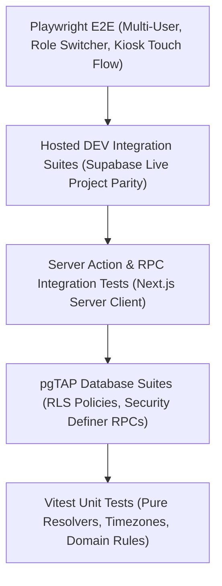

# The Lineup V2.0 — Test Strategy & Verification Matrix

## 1. Layered Testing Architecture

The Lineup V2.0 employs a strict multi-layer testing pyramid to ensure absolute isolation across organizations, locations, and roles.

---

## 2. Test Layers and Tooling

| Test Layer                   | Framework / Runner                           | Scope & Targets                                                                                          | Execution Frequency               |
| ---------------------------- | -------------------------------------------- | -------------------------------------------------------------------------------------------------------- | --------------------------------- |
| **1. Domain Unit**           | Vitest                                       | Pure capability resolver, role precedence, timezone conversion, kiosk token hash functions.              | Every file edit / Pre-commit      |
| **2. Database & RLS**        | pgTAP + Supabase CLI                         | `private.has_org_role`, `location_assignments`, RLS select/insert/update/delete policies across tenants. | Every migration / PR CI           |
| **3. Server Actions & RPCs** | Vitest (node environment)                    | Server Actions, Zod validation schemas, idempotency tokens, error handling.                              | Local gate / PR CI                |
| **4. Hosted DEV Suites**     | Vitest (`--testPathPattern=hosted`)          | Verification against real hosted Supabase DEV database (`opmujepkemwcdxxorhfd`).                         | Subfeature completion             |
| **5. Playwright E2E**        | Playwright (Chromium, WebKit, Mobile Safari) | Complete multi-user workflows: login, context switcher, allocation board, kiosk PIN clocking.            | Feature completion / Release gate |

---

## 3. Mandatory Acceptance Scenarios

### 3.1. The Canonical User Access Matrix

Must be covered by both pgTAP policies and Playwright browser tests:

1. **Jack**: Allow Monks/Webster, Allow Liquor Tap/NASA, Allow Liquor Tap/League City.
2. **Sam**: Allow Liquor Tap/NASA; Deny Liquor Tap/League City; Deny Monks/Webster.
3. **Tom**: Allow Monks/Webster; Deny Liquor Tap/NASA.
4. **Jerry**: Allow Monks/Webster, Allow Liquor Tap/NASA; Deny Liquor Tap/League City.
5. **John (Mixed Branch Roles)**: Manager at NASA, Assistant Manager at League City, Manager at Webster.

### 3.2. Critical Security & Edge-Case Test Scenarios

Every feature touching authorization or state must include automated assertions for:

- [ ] **Inactive Membership**: When `memberships.active = false`, user is denied everywhere in that organization immediately.
- [ ] **Inactive Location**: When `locations.active = false`, non-owner access is rejected.
- [ ] **Revoked Location Assignment**: When `location_assignments.active = false`, user loses access to that specific location while retaining access to other assigned locations.
- [ ] **Stale Active Context**: If a user is removed from a location while a browser session is open, subsequent mutations fail with `42501 Unauthorized`.
- [ ] **Cross-Tab Synchronization**: Switching location in Tab A sends a broadcast event that updates or alerts Tab B to prevent stale-context overwrites.
- [ ] **Forged Organization ID**: Client supplying a foreign `organization_id` in Server Actions is rejected by membership check.
- [ ] **Forged Location ID**: Client supplying a `location_id` they are not assigned to is rejected by RLS / RPC assertions.
- [ ] **Role Escalation Attempt**: Staff user attempting to execute manager RPCs or mutate settings receives `42501`.
- [ ] **Overall Role Baseline**: Overall Owner/Manager automatically accesses newly added locations without explicit assignment.
- [ ] **Kiosk Fail-Closed**:
  - Unpaired device attempting clock event fails immediately.
  - Revoked device attempting clock event fails with `42501`.
  - Clocking in at a location configured with `EXTERNAL` attendance fails with error `Attendance mode is external`.
  - Clocking in at a location configured with `DISABLED` attendance fails with error `Attendance is disabled`.
